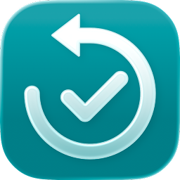
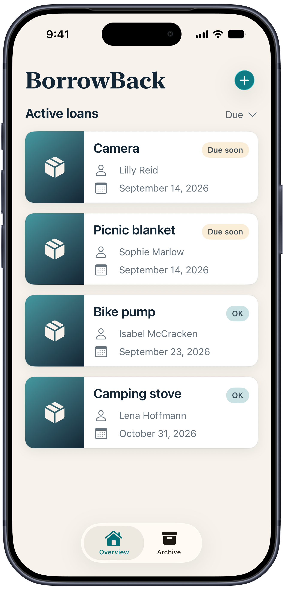
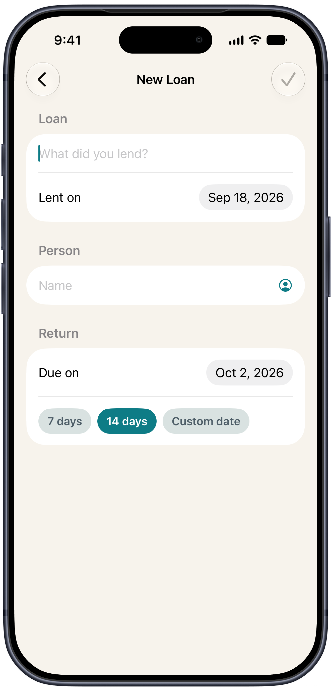
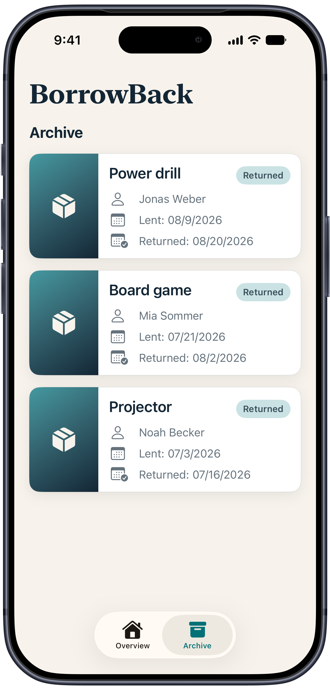

<p align="center">
  
</p>

<h1 align="center">BorrowBack</h1>

<p align="center">
  <strong>Keep track of what you lend — and get it back.</strong>
</p>

<p align="center">
  A calm, native iOS app for recording lent items, borrowers, due dates, and returns.
</p>

<p align="center">
  <a href="https://opensource.org/license/mit"></a>
  <a href="https://github.com/timokoethe/BorrowBack/releases/latest"></a>
  
  
  
</p>

## At a Glance

BorrowBack keeps the full lifecycle of a loan in one place: create it, see what
is due, mark it as returned, and find it again in the archive. The interface is
purposefully small and uses native iOS patterns throughout.

<p align="center">
  
  &nbsp;
  
  &nbsp;
  
</p>

<p align="center">
  <sub>Active loans · Add a loan · Returned-loan archive</sub>
</p>

## Highlights

- **Stay oriented:** See active loans at a glance, including borrower, due date,
  and a clear status indicator.
- **Capture the essentials:** Record an item, borrower, lending date, and due
  date in a focused form.
- **Use the system contact picker:** Link a borrower without granting the app
  broad access to the Contacts database.
- **Complete the lifecycle:** Edit, return, restore, archive, and delete loans.
- **Find what matters first:** Sort active loans by due date, creation date,
  title, or borrower.
- **Keep data available:** Store loans locally with SwiftData and synchronize
  them through the user's private iCloud database.
- **Use the app in English or German:** Interface text and date presentation
  respond to the selected locale.

The behavior of every implemented feature is documented in
[`docs/features/`](docs/features/), including
[onboarding](docs/features/onboarding.md),
[loan status](docs/features/loan-status.md),
[the archive](docs/features/loan-archive.md), and
[iCloud sync](docs/features/icloud-sync.md).

## Privacy by Design

BorrowBack does not request general Contacts access. Contact selection happens
in Apple's out-of-process picker, and the app retains only the selected contact
identifier and display name. Loan data synchronizes through the user's private
CloudKit database.

The current [privacy manifest](app/apple/BorrowBack/PrivacyInfo.xcprivacy)
declares no tracking, collected data, or required-reason API use.

## Technology

| Area | Implementation |
| --- | --- |
| Interface | SwiftUI |
| Persistence | SwiftData |
| Synchronization | Private CloudKit database |
| Contact linking | Native system contact picker |
| Localization | String Catalog with English and German |
| Website | Next.js and TypeScript |

## Getting Started

### Native iOS app

You need Xcode 26 or later and an iPhone or simulator running iOS 26 or later.

Open the project and run the `BorrowBack` scheme:

```sh
open app/apple/BorrowBack.xcodeproj
```

Because runtime persistence uses CloudKit, installing and running the app
requires a regularly signed build. For a signing-independent compile check,
use:

```sh
DEVELOPER_DIR=/Applications/Xcode.app/Contents/Developer xcodebuild \
  -project app/apple/BorrowBack.xcodeproj \
  -scheme BorrowBack \
  -destination 'generic/platform=iOS' \
  -derivedDataPath /tmp/borrowback-build \
  CODE_SIGNING_ALLOWED=NO build
```

This verifies compilation but does not produce an app that can run with its
iCloud-backed container.

### Website

The separate landing page lives in [`website/`](website/). To run it locally:

```sh
cd website
npm ci
npm run dev
```

Then open [http://localhost:3000](http://localhost:3000). See the
[website README](website/README.md) for scripts and deployment details.

## Repository Layout

```text
BorrowBack/
├── app/apple/       Native iOS app and Xcode project
├── docs/features/   Observable feature behavior and acceptance criteria
└── website/         Separate Next.js landing page
```

## Releases

Stable releases use tags such as `v1.1.0`; beta releases use tags such as
`v1.1.0-beta1`. A pushed release tag creates the corresponding GitHub Release
and deploys the website to Vercel. Native builds run separately in Xcode Cloud.

See [docs/release.md](docs/release.md) for the complete release and verification
process.

## Contributing

Contributions are welcome. Please keep changes focused and read
[CONTRIBUTING.md](CONTRIBUTING.md) before opening a pull request.

Report security issues privately as described in [SECURITY.md](SECURITY.md).

## License

BorrowBack is available under the [MIT License](LICENSE).
