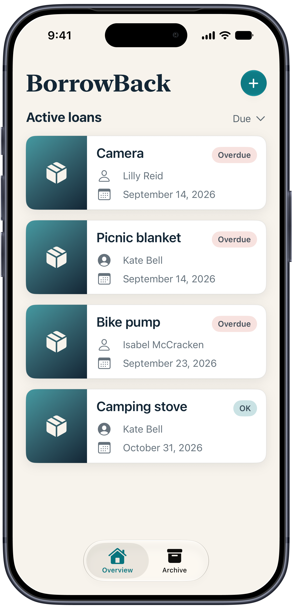
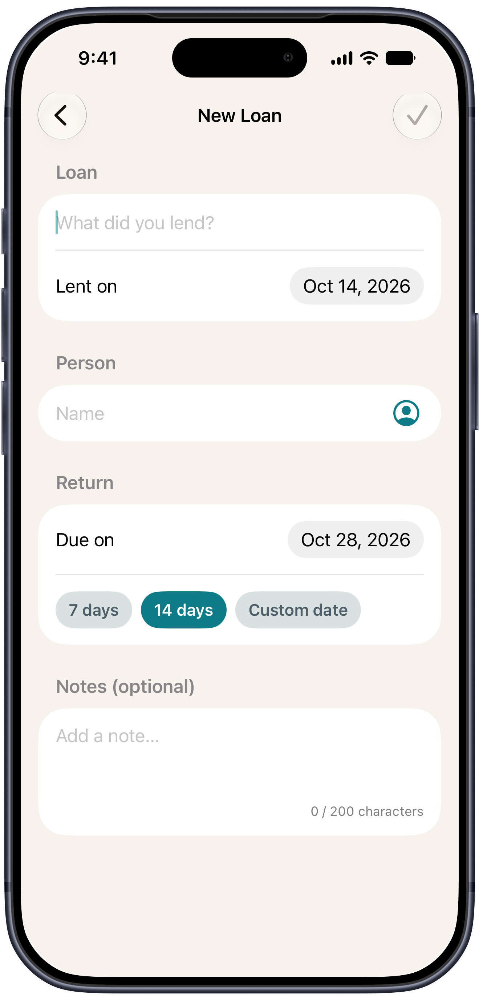
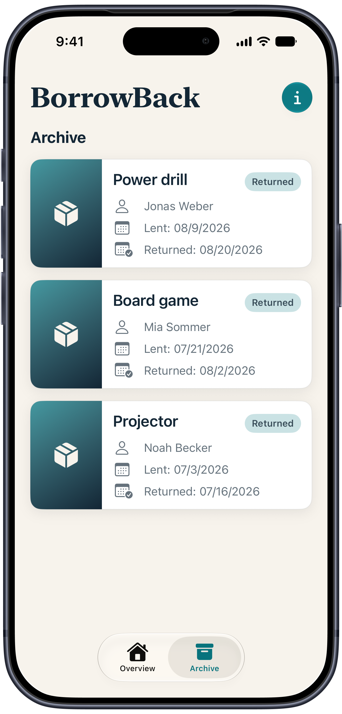

<p align="center">
  
</p>

<h1 align="center">BorrowBack</h1>

<p align="center">
  <strong>Keep track of what you lend — and get it back.</strong>
</p>

<p align="center">
  A calm, native iOS app for recording lent items, borrowers, due dates, and returns.
</p>

<p align="center">
  <a href="https://opensource.org/license/mit"></a>
  <a href="https://github.com/timokoethe/BorrowBack/releases/latest"></a>
  
  
  
</p>

## At a Glance

BorrowBack is available for free on the
[App Store](https://apps.apple.com/de/app/borrowback-verleih-tracker/id6803524362).
Visit the [website](https://borrowback.itstimo.me/) for features and FAQs.

<p align="center">
  
  &nbsp;
  
  &nbsp;
  
</p>

<p align="center">
  <sub>Active loans · Add a loan · Returned-loan archive</sub>
</p>

## Highlights

- **Stay oriented:** See active loans at a glance, including borrower, due date,
  and a clear status indicator.
- **Capture the essentials:** Record an item, borrower, lending date, and due
  date in a focused form.
- **Use the system contact picker:** Link a borrower without granting the app
  broad access to the Contacts database.
- **Follow up:** Edit a reminder for a linked contact, then send it through
  the system SMS/iMessage composer or copy the text.
- **Complete the lifecycle:** Edit, return, restore, archive, and delete loans.
- **Find what matters first:** Sort active loans by due date or item name.
- **Keep data available:** Store loans locally with SwiftData and synchronize
  them through the user's private iCloud database.
- **Use the app in English or German:** Interface text and date presentation
  respond to the selected locale.

See [feature documentation](docs/features/) for behavior and acceptance criteria.

## Privacy by Design

Loan records stay on your device and, when enabled, in your private iCloud
database. The developer cannot access them. The app has no analytics, ads,
or developer-operated backend.

The system contact picker shares only the contact you select, without granting
broad Contacts access. Reminders are sent only after you confirm them.

See the [privacy policy](https://borrowback.itstimo.me/privacy) and
[privacy manifest](app/apple/BorrowBack/PrivacyInfo.xcprivacy) for details.
The website uses Vercel Web Analytics separately from the app.

## Getting Started

### Native iOS app

You need Xcode 26 or later and an iPhone or simulator running iOS 26 or later.

Open the project and run the `BorrowBack` scheme:

```sh
open app/apple/BorrowBack.xcodeproj
```

Running the app requires signing with your own Apple Developer team and iCloud
container. See [native development](docs/development.md) for setup and an unsigned
compile check. Debug builds refresh sample loans on launch; use a development
account because these records can sync to iCloud.

### Website

The separate landing page lives in [`website/`](website/). To run it locally:

```sh
cd website
npm ci
npm run dev
```

Then open [http://localhost:3000](http://localhost:3000). See the
[website README](website/README.md) for scripts and deployment details.

## Repository Layout

```text
BorrowBack/
├── app/apple/       Native iOS app and Xcode project
├── docs/features/   Observable feature behavior and acceptance criteria
└── website/         Separate Next.js landing page
```

## Releases

Release tags create GitHub Releases and deploy the website; Xcode Cloud builds
the native app separately. See [release documentation](docs/release.md) for
tag formats and verification.

## Contributing

Contributions are welcome. Please keep changes focused and read
[CONTRIBUTING.md](CONTRIBUTING.md) before opening a pull request.

Report security issues privately as described in [SECURITY.md](SECURITY.md).

## License

BorrowBack is available under the [MIT License](LICENSE).
